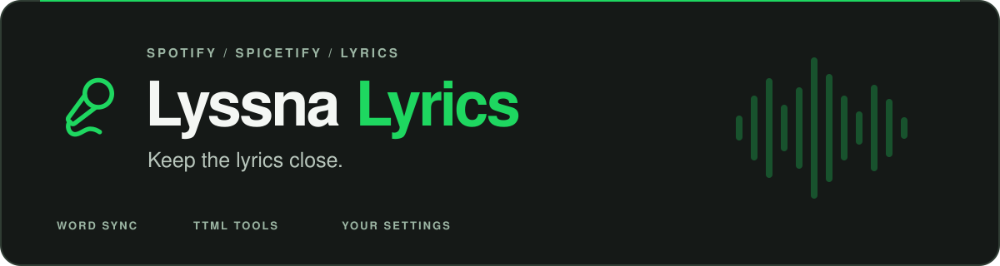

<div align="center">



<p>
  <a href="https://discord.gg/qfYAsFQawp"></a>
  <a href="#install"></a>
  <a href="LICENSE"></a>
</p>

**Rewrite planned.**

**[Discord & support](https://discord.gg/qfYAsFQawp) · [Download the launcher](https://ipixelgalaxy.com/lyssna-plugin/download.html) · [Lyssna Standalone](https://clypdat.xyz/lyssna.exe)**

</div>

Lyssna Lyrics puts synchronized lyrics inside Spotify, with a microphone button to open them, a toolbar that follows your layout, and settings you can make your own.

This is iPixelGalaxy's fork of [Spicy Lyrics](https://github.com/Spikerko/spicy-lyrics), bringing the look of [Lyssna](https://github.com/Stormanzanii/Lyssna) to Spicetify. If you knew this repo as Pixel Edition, you're in the right place.

## In the lyrics view

| | What you can do |
| :-- | :-- |
| **Follow the song** | Word and line timing, duet alignment, romanization, and a button to return to the active line. Timing depends on the lyrics available for each track. |
| **Pick a view** | Keep lyrics on the page, go fullscreen or Cinema, open a popout, or use the Now Playing sidebar. |
| **Make it yours** | Change the font and lyric size, choose Spring or Bloom, try Space Gravity, and adjust backgrounds and animation limits. Dialogs are solid by default, with optional Liquid Glass. |
| **Work with TTML** | Load lyrics temporarily, for the session, or persistently. Browse your local TTML database and apply a reviewer profile while checking a file. |
| **Choose your sources** | Reorder and enable lyric sources, choose the toolbar's cache action, and keep provider and contributor credits beside the lyrics. |

Open the gear in the lyrics toolbar for **Appearance, Lyrics, Effects, Layout, Sources, Advanced, and Credits**. The toolbar moves into a vertical strip when the lyrics pane gets narrow.

## Install

Start with **Spotify's desktop app and a working [Spicetify installation](https://spicetify.app/docs/getting-started)**. The commands below install the extension and apply Spicetify; Spotify may restart.

### Windows · PowerShell

```powershell
& ([scriptblock]::Create((irm 'https://raw.githubusercontent.com/iPixelGalaxy/lyssna-lyrics/dev/scripts/lyssna-lyrics.ps1'))) -Action install
```

### macOS / Linux · Terminal

```sh
sh -c 'lyssna_script=$(curl -fsSL https://raw.githubusercontent.com/iPixelGalaxy/lyssna-lyrics/dev/scripts/lyssna-lyrics.sh) && sh -c "$lyssna_script" -- install'
```

The installer downloads **[lyssna-lyrics.mjs](https://ipixelgalaxy.com/lyssna-plugin/download.html)** from this GitHub repo and enables that filename. It replaces the old `spicy-lyrics-pixel.mjs` entry. Spicy Lyrics can stay installed and enabled alongside Lyssna, with a separate button and settings panel for each.

You can read the [launcher source](builds/lyssna-lyrics.mjs), [PowerShell script](scripts/lyssna-lyrics.ps1), or [shell script](scripts/lyssna-lyrics.sh) here. The launcher loads the repository's v2 entrypoint through jsDelivr. Running the install command again replaces the launcher with the current copy.

<details>
<summary><strong>Install manually</strong></summary>

1. Download [lyssna-lyrics.mjs](https://ipixelgalaxy.com/lyssna-plugin/download.html) and save it with that exact filename.
2. Run `spicetify config-dir` and place the file in its **Extensions** folder.
3. Enable Lyssna and replace the old Pixel entry:

   ```sh
   spicetify config extensions lyssna-lyrics.mjs
   spicetify config extensions spicy-lyrics-pixel.mjs-
   spicetify apply
   ```

After Spotify reloads, open lyrics with the microphone button. [Spicetify's extension guide](https://spicetify.app/docs/customization/extensions) covers its manual installation process.

</details>

## Uninstall

### Windows · PowerShell

```powershell
& ([scriptblock]::Create((irm 'https://raw.githubusercontent.com/iPixelGalaxy/lyssna-lyrics/dev/scripts/lyssna-lyrics.ps1'))) -Action uninstall
```

### macOS / Linux · Terminal

```sh
sh -c 'lyssna_script=$(curl -fsSL https://raw.githubusercontent.com/iPixelGalaxy/lyssna-lyrics/dev/scripts/lyssna-lyrics.sh) && sh -c "$lyssna_script" -- uninstall'
```

This disables the Lyssna and old Pixel entries, reapplies Spicetify, and removes their launcher files. **Your saved lyric preferences are kept**, including settings shared with Spicy Lyrics.

## Switching from Pixel Edition or Spicy Lyrics

The new installer handles the old Pixel extension entry. Lyssna and Spicy Lyrics can run together. Their pages, controls, local TTML collections, branch selections, and update history stay separate. Existing local TTML files are copied into Lyssna's collection on first use.

Compatible preferences remain shared by default. Enable **Don't sync settings to Spicy Lyrics counterparts** under **Advanced** to keep your Lyssna setup independent. Turning it off resumes sharing compatible preferences.

In **Settings → Advanced → Build Channel**, **Lyssna** is the default. **Spicy Lyrics** loads the official plugin when it isn't already enabled separately. You can also manage custom branches or pin a version. The entrypoint and the in-plugin picker use the same Lyssna channel selection.

Lyssna's release series begins at **0.1.0**. Historical **100.10.x** Pixel Edition versions come before the new series in update checks and patch notes.

Community and Apple Music lyrics use the public Spicy Lyrics developer API. Other available sources include Musixmatch, Spotify, LRCLIB, and NetEase. Source availability varies by track; manage their order in **Settings → Sources**. The fork's private plugin API integration has been removed.

## Want a break from the lag?

**[Download Lyssna Standalone for Windows](https://clypdat.xyz/lyssna.exe)**, or visit [Arashii's Lyssna project](https://github.com/Stormanzanii/Lyssna).

If you're staying in Spotify, try **Limit Animation Frame Rate** in Appearance and turn off effects you don't use.

## Bugs, ideas, and updates

**[Join the Lyssna Discord](https://discord.gg/qfYAsFQawp)** for fork updates and support.

For a bug report, open **Settings → Report a bug** and copy the diagnostics. Post them in **#extension-bugs**, along with what happened, how to reproduce it, and a screenshot when it helps. The report includes the versions, lyric source, and settings that help us investigate.

You can also [open a GitHub issue](https://github.com/iPixelGalaxy/lyssna-lyrics/issues). Please include the song and the affected view when reporting a lyrics problem.

## Credits

- **[Spicy Lyrics](https://github.com/Spikerko/spicy-lyrics)** by Spikerko and its contributors, for the plugin and lyric renderer this fork is built on.
- **[Lyssna](https://github.com/Stormanzanii/Lyssna) · Arashii**, for the name, microphone icon, settings and toolbar designs.
- **[iPixelGalaxy](https://github.com/iPixelGalaxy)**, for maintaining this fork.

## License and history

See [LICENSE](LICENSE) for the GNU Affero General Public License, version 3, and [the icon license](src/assets/LUCIDE_LICENSE.txt) for the microphone artwork.

[Patch notes](.change-notes/PATCH_NOTES.md) · [Feature notes](.change-notes/FEATURE_CHANGES.md) · **[Archived README and release history](README.archive.md)**
